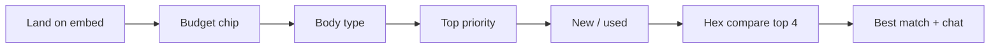

# Shopper funnel — quiz → scores → shortlist

Attention narrative for **dealers** (embed ROI) and **shoppers** (why the quest is short). Maps to the shipped POC stages in `backend/recommendation_engine.py`.

## Hook (dealer site hero / widget)

> **3 cars that fit how you drive** — not every car on the lot.

DriveQuest replaces endless filter grids with a **60-second quest** and a **three-car shortlist** scored on the same six axes your team already cares about: value, budget fit, reliability, efficiency, safety, practicality.

---

## Funnel stages

| Stage | Shopper question | System action | Dealer value |
|-------|------------------|---------------|--------------|
| **1 — Budget** | “What’s the most you’re comfortable spending?” | Sets max price; soft-filters lot (+5% headroom) | Qualifies spend before salesperson time |
| **2 — Body** | Sedan, SUV, truck, … | Hard filter on `body_type` | Routes to right segment on the lot |
| **3 — Priority** | Reliability, deal, efficiency, space, safety | **Doubles weight** on matching hex axis | Surfaces inventory that matches stated intent |
| **4 — Condition** | New, used, either | Filters `condition` | Aligns with aged inventory strategy |
| **5 — Compare** | Keep / pass on contenders | Radar on up to four cars; optional shortlist | Keeps shopper on-site comparing **your** stock |
| **6 — Decide** | Best match or start over | Ranks by weighted overall score; persona explains tradeoffs | Delivers **1–3 named units** for test drive |

Free-text chat can jump stages (“under 25k hybrid”, “reset”) — same underlying `PreferenceState`.

---

## Scoring layer (between quiz and shortlist)

For every car that passes filters, DriveQuest computes six axis scores (0–10) from inventory fields:

| Axis | Shopper language | Main inputs |
|------|------------------|-------------|
| Value | “Am I getting a fair deal?” | `price` vs `market_value` |
| Budget fit | “Does this feel comfortable under my max?” | `price` vs stated budget |
| Reliability | “Will this hold up?” | `reliability` |
| Efficiency | “What will fuel/charge cost?” | `mpg`, `fuel_type` |
| Safety | “Is my family protected?” | `safety_rating` |
| Practicality | “Does it fit my life?” | `seats`, `body_type`, `mileage` |

**Overall rank** = weighted average of the six axes. Priority choice from step 3 sets a **2× weight** on one axis; EV lean (when collected) nudges efficiency/value or practicality.

Optional EV vs gas preference adjustments run through `backend/ev_tradeoffs.py` — transparent bumps, not hidden reranking.

---

## Shortlist contract

After stage 4, `rank_cars(..., limit=5)` returns the top matches; the compare UI emphasizes **up to four** on the hex chart. The attention moment:

1. Shopper sees **three names they recognize** (year/make/model), not twenty VIN rows.
2. Radar shows **why** each car wins or loses on the axis they said mattered most.
3. Advisor chat (demo or live) reinforces the top pick with honest downsides — commission-neutral persona.

**Success:** shopper leaves with **≤3 units** to test-drive and a shared vocabulary (the six axes) for the F&I desk.

---

## What partners can measure (POC)

| Event (conceptual) | Meaning |
|--------------------|---------|
| `quest_started` | Embed loaded, session created |
| `stage_completed` | Each chip stage |
| `shortlist_shown` | Compare stage with ≥1 contender |
| `best_match` | Decide stage — primary conversion |

Iter 3 may formalize a privacy-safe event schema for embed partners; this funnel is the behavioral model those events should follow.

---

## See also

- [problem.md](./problem.md) — choice overload and KPIs
- [shopper-experience.md](./shopper-experience.md) — UI and persona detail
- [drivequest_eda_summary.md](../reports/drivequest_eda_summary.md) — how priority choice moves rankings on the public fixture